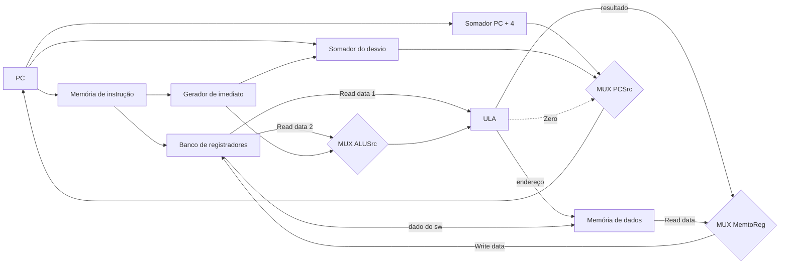

# Processador e Datapath RISC-V (Microprocessador I)

← [[06 - Mapeamento de Cache (Direto, Associativo, Por Conjunto)]] | [[00 - Índice - Organização de Computadores|Índice]] | Próxima: [[10 - Interrupções e Entrada-Saída (Microprocessador III)]]

Depois de barramento ([[02 - Barramentos (Buses)]]) e memória ([[03 - Hierarquia e Tipos de Memória]]), o professor passa para o terceiro bloco da arquitetura von Neumann: a **CPU**. Na prova, esta nota corresponde ao tópico 4 (Processador): ciclo de busca e execução, funcionamento do circuito de controle e execução dos 3 tipos de instrução.

> [!info] Dois decks nesta nota
> - **Microprocessador I** (`OrgComp06`): abstração, desempenho, ISA, Assembly RISC-V, montagem do datapath e execução de `add`, `lw` e `beq`.
> - **Microarquitetura de Ciclo Único** (`ArqComp_Aula4-Revisao`): o cabeçalho diz "Arquitetura de Computadores", outra disciplina do mesmo professor, e o nome do arquivo indica que é revisão. Ele repete a montagem do datapath e os 3 exemplos, e acrescenta o que o Microprocessador I não tem: **o controle** (controle da ULA, os seis sinais, a tabela-verdade por opcode) e o caminho destacado de cada instrução.
>
> Quando digo "deck de ciclo único", é o segundo. A aula sobre a ULA e a de pipeline, citadas no resumo do Microprocessador III, não estão neste vault.

## 1. 80 anos de abstração (slide 3 do Microprocessador I)

O slide mostra o computador como uma pilha de camadas, do software até a fabricação do chip:

```
Software   Aplicação (ex.: browser)
           Compilador · Assembler · Sistema Operacional
────────── ISA: Arquitetura de Conjunto de Instruções ──────────
Hardware   Processador · Memória · I/O
           Datapath e Controle
           Projeto Digital
           Projeto de Circuito
           Transistores
           Nanofabricação
```

A faixa azul do slide é a **ISA**, a fronteira entre software e hardware. Uma elipse tracejada vermelha marcada "AC" envolve a ISA, o nível processador/memória/I/O, o datapath e controle e o projeto digital. O slide não explica a sigla; pelo contexto, deve ser **Arquitetura de Computadores**, ou seja, as camadas que a disciplina estuda.

## 2. Conceitos básicos (slide 4)

Frase central do slide: **as operações executadas no processador têm como operandos os registradores**. A ULA não opera direto sobre a memória; os valores precisam estar em registradores.

O diagrama do slide mostra a CPU com três blocos: Registradores (Register), ULA (ALU) e Unidade de Controle (CU). Fora dela ficam a Memória Principal, a Memória Secundária, os dispositivos de entrada e os de saída. A legenda separa dois tipos de seta:

- **Pontilhada (dados e instruções)**: entrada → memória principal → saída; memória principal ⇄ memória secundária; memória principal ⇄ registradores ⇄ ULA.
- **Contínua (comandos e sinais de controle)**: saem da Unidade de Controle para todos os outros blocos.

## 3. Do alto nível ao binário (slide 5)

1. O código em alto nível é **compilado**, ou seja, convertido em instruções da arquitetura do processador.
2. O resultado é o **Assembly**. Numa arquitetura RISC, cada instrução representa uma operação do processador.
3. O **Assembler** transforma o Assembly no código binário que o processador executa.

Exemplo da figura: a função `swap` em C, que troca `v[k]` com `v[k+1]`, vira este Assembly RISC-V:

```asm
swap:
    slli x6, x11, 3     # x6 = k deslocado 3 bits à esquerda (k × 8)
    add  x6, x10, x6    # x6 = endereço de v[k] (x10 = início do vetor)
    lw   x5, 0(x6)      # x5 = v[k]
    lw   x7, 4(x6)      # x7 = v[k+1]
    sw   x7, 0(x6)      # v[k] = x7
    sw   x5, 4(x6)      # v[k+1] = x5
    jalr x0, 0(x1)      # retorna (x1 = endereço de retorno)
```

Os comentários depois de `#` são meus, não estão no slide. Cada linha vira uma palavra de 32 bits no binário.

> [!note] Detalhe da figura
> `slli ..., 3` multiplica `k` por 8, mas os acessos usam deslocamento 4 (`lw`/`sw` de 4 bytes). Com palavras de 4 bytes, o esperado seria `slli x6, x11, 2`. Parece uma mistura entre a versão de 64 bits do exemplo (que usa `ld`/`sd` e deslocamento 8) e a de 32 bits. Não muda a ideia do slide, que é mostrar as três etapas: compilador, assembler, binário.

## 4. Como medir o desempenho do processador (slides 6-8)

Dois parâmetros principais:

1. **Tempo de execução (ou tempo de resposta)**: tempo total para completar uma tarefa.
$$\text{Performance} = \frac{1}{\text{Tempo de execução}}$$
2. **Throughput (vazão)**: tarefas completas por unidade de tempo.
$$\text{Performance} = \frac{\text{Número de tarefas executadas}}{\text{Tempo}}$$

### Tempo de execução dividido em três partes

1. **Tempo de CPU**: o tempo que a CPU gastou computando aquela tarefa, sem contar E/S ou outros programas.
$$\text{Tempo de CPU} = \text{Ciclos de clock do programa} \times \text{Período do clock} = \frac{\text{Ciclos de clock do programa}}{\text{Taxa de clock}}$$
2. **Tempo de CPU do usuário**: o tempo que a CPU gastou no programa em si.
3. **Tempo de CPU do sistema**: o tempo que a CPU gastou no sistema operacional para que o programa pudesse rodar.

O slide destaca que o tempo de execução de um programa e o tempo de CPU são coisas diferentes, e que essa diferença é parte do que separa o desempenho entre linguagens de alto nível.

### CPI e a equação clássica

Cada microarquitetura tem um número médio de ciclos de clock por instrução, o **CPI**:

$$\text{Nº de ciclos de clock} = \text{Nº de instruções} \times \text{CPI}$$

$$\text{Tempo de CPU} = \frac{\text{Nº de instruções} \times \text{CPI}}{\text{Taxa de clock}}$$

> [!tip] Três alavancas do desempenho
> Pela equação clássica, o tempo de CPU cai se o programa tiver menos instruções (compilador, ISA), se cada instrução gastar menos ciclos (microarquitetura) ou se o clock for mais rápido. Mexer em uma pode piorar outra. Ver o exercício 5 na seção 13.

## 5. ISA x microarquitetura (slide 9; repetido no slide 2 do deck de ciclo único)

A **ISA (Instruction Set Architecture, Arquitetura de Conjunto de Instruções)** define como as operações são realizadas pela arquitetura nos registradores.

- Serve de manual para o programador saber como interagir com o hardware.
- O projetista de hardware usa a ISA para definir a microarquitetura do processador.

Nomenclatura que o slide pede para guardar:

- **Arquitetura**: qual ISA o processador usa.
- **Microarquitetura**: a implementação do processador que usa aquela ISA.

Uma arquitetura tem várias microarquiteturas possíveis. Exemplo do slide: vários processadores Intel implementam o x86, mas com microarquiteturas diferentes.

## 6. Assembly do RISC-V (slide 10)

Formato de todas as instruções:

```
{instrução} {registrador destino} {registrador(es) fonte}
```

Exemplo: `add x5, x6, x7` é o mesmo que `x5 = x6 + x7`.

Tabela de registradores do slide:

| Nome | Registrador | Uso |
|---|---|---|
| zero | x0 | Constante 0 |
| ra | x1 | Endereço de retorno |
| sp | x2 | Ponteiro de pilha (stack pointer) |
| gp | x3 | Ponteiro global |
| tp | x4 | Ponteiro de thread |
| t0-2 | x5-7 | Temporários |
| s0/fp | x8 | Salvo / ponteiro de quadro (frame pointer) |
| s1 | x9 | Salvo |
| a0-1 | x10-11 | Argumentos de função / valores de retorno |
| a2-7 | x12-17 | Argumentos de função |
| s2-11 | x18-27 | Salvos |
| t3-6 | x28-31 | Temporários |

São 32 registradores (x0 a x31), por isso os campos de registrador nas instruções têm 5 bits (2⁵ = 32).

## 7. Implementação básica: o subconjunto do RV32I (slide 11; slides 3 e 14 do deck de ciclo único)

O curso estuda um subconjunto do RV32I:

- Acesso à memória: `lw` e `sw`
- Lógicas e aritméticas: `add`, `sub`, `and`, `or`
- Desvio (branch): `beq`

O deck de ciclo único acrescenta que, por enquanto, não serão vistas todas as instruções lógico-aritméticas nem as de ponto flutuante, e destaca:

> [!important] Os dois primeiros passos são iguais para todas as instruções
> 1. O PC aponta o endereço de memória de onde a instrução é buscada.
> 2. Um ou dois registradores são lidos, usando os campos da instrução para escolher quais.

Formatos das instruções (campos do bit 31 ao bit 0):

| Formato | 31:25 | 24:20 | 19:15 | 14:12 | 11:7 | 6:0 | Usado por |
|---|---|---|---|---|---|---|---|
| R | funct7 | rs2 | rs1 | funct3 | rd | opcode | `add`, `sub`, `and`, `or` |
| I | immediate[11:0] | (continua) | rs1 | funct3 | rd | opcode | `lw` |
| S | immed[11:5] | rs2 | rs1 | funct3 | immed[4:0] | opcode | `sw` |
| SB | immed[12,10:5] | rs2 | rs1 | funct3 | immed[4:1,11] | opcode | `beq` |

`rs1` e `rs2` são os registradores fonte, `rd` é o destino. A coluna "Usado por" é minha, juntando a lista de instruções do slide com os formatos. No tipo I, o imediato de 12 bits ocupa as duas primeiras colunas juntas (bits 31:20). Nos tipos S e SB o imediato fica partido em dois pedaços. O slide não explica o motivo; a explicação usual é manter `rs1`, `rs2`, `funct3` e `opcode` sempre na mesma posição em todos os formatos, o que simplifica a decodificação. Isso aparece no slide 14 do deck de ciclo único: "não precisamos trabalhar com todos os bits da instrução em cada bloco de controle".

## 8. Montando o datapath (slides 12-16; slides 6-11 do deck de ciclo único)

Um processador tem dois fluxos:

- **Datapath**: os componentes que realizam as operações.
- **Controle**: os componentes que comandam o datapath, a memória e a E/S de acordo com a instrução.

Antes das peças, o deck de ciclo único (slide 6) relembra **circuitos sequenciais x combinacionais**. Circuitos sequenciais têm estado e precisam de um pulso de clock para mudar esse estado; o curso sempre considera a **borda de subida**. O desenho mostra elemento de estado 1 → lógica combinacional → elemento de estado 2, dentro de um ciclo de clock. Com a metodologia disparada por borda, um elemento de estado pode ser **lido e escrito no mesmo ciclo**, por isso o PC pode ser lido e receber PC + 4 no mesmo ciclo, e o banco de registradores pode ser lido e escrito na mesma instrução. No datapath, o PC, o banco de registradores e as memórias são os elementos de estado; ULA, somadores e MUXes são lógica combinacional.

### 8.1 Busca da instrução (fetch)

Peças necessárias:

1. **Memória de instrução**: guarda o programa. Entra um endereço, sai a instrução.
2. **PC (Program Counter)**: guarda o endereço da instrução que deve ser lida.
3. **Somador**: incrementa o endereço para a próxima instrução.

No slide 13, a saída do PC vai para o "Read address" da memória de instrução e também para um somador que soma **4** (cada instrução tem 4 bytes). O resultado volta para o PC.

### 8.2 Instruções do tipo R (slide 14)

1. **Banco de registradores**: conjunto de registradores acessados por endereço. Tem duas entradas de leitura (Read register 1 e 2, de 5 bits cada), uma de escrita (Write register, 5 bits), a entrada Write data e duas saídas (Read data 1 e 2), porque as instruções R leem dois registradores. A escrita só acontece com o sinal **RegWrite** ativo.
2. **ULA**: um sinal de controle de 4 bits (**ALU operation**) escolhe a operação. Saídas: o resultado (ALU result) e o sinal **Zero**, que indica se o resultado deu 0.

### 8.3 Acesso à memória: lw e sw (slide 15)

1. **Memória de dados**: recebe o endereço (Address) e, na escrita, o dado (Write data). Os sinais **MemRead** e **MemWrite** dizem se é leitura ou escrita. Na leitura, o valor sai em Read data.
2. **Gerador de imediato (Imm Gen)**: tira da instrução o deslocamento (offset) usado para calcular o endereço.

### 8.4 Desvio: beq (slide 16)

1. Verificar se o desvio vai acontecer: a ULA compara os dois registradores e manda o sinal Zero para a lógica de desvio.
2. Se acontecer, gerar o novo endereço a partir do imediato e do PC atual: um somador separado calcula PC + imediato (Branch target).

## 9. Datapath básico completo (slide 17)

O slide 17 junta tudo num datapath só (o deck de ciclo único mostra a mesma ideia nos slides 4, "Visão abstrata", e 12). Três multiplexadores escolhem entre duas entradas conforme o controle:

- **MUX ALUSrc**: o segundo operando da ULA vem do registrador (Read data 2, entrada 0) ou do imediato (entrada 1).
- **MUX MemtoReg**: o valor escrito de volta no banco vem da ULA (entrada 0) ou da memória de dados (entrada 1).
- **MUX PCSrc**: o próximo PC é PC + 4 (entrada 0) ou o endereço do desvio (entrada 1).

O slide 15 do deck de ciclo único mostra quais bits da instrução vão para cada bloco:

| Bits da instrução | Vão para |
|---|---|
| [6-0] (opcode) | Unidade de controle principal |
| [19-15] (rs1) | Read register 1 |
| [24-20] (rs2) | Read register 2 |
| [11-7] (rd) | Write register |
| [31-0] (a instrução toda) | Gerador de imediato |
| [30, 14-12] (bit 30 do funct7 e o funct3) | Controle da ULA |

Versão simplificada do datapath (os rótulos em português são meus):



A seta pontilhada indica que o Zero da ULA participa da decisão do PCSrc no `beq` (seção 10.5).

## 10. Funcionamento do circuito de controle

Esta seção vem dos slides 13 a 18 e 24 do deck de ciclo único. O Microprocessador I só diz que, na etapa 2 de cada instrução, "a unidade de controle computa qual a configuração das linhas de controle".

### 10.1 Dois blocos de controle (slides 15 e 17)

O controle é dividido em dois blocos, e cada um olha só para os bits da instrução de que precisa:

1. **Unidade de controle principal**: recebe o **opcode** (bits 6-0) e gera os sinais Branch, MemRead, MemtoReg, **ALUOp** (2 bits), MemWrite, ALUSrc e RegWrite.
2. **Controle da ULA**: recebe o ALUOp mais os bits 30 e 14-12 da instrução, e gera as 4 linhas de controle da ULA (o "ALU operation").

### 10.2 Controle da ULA (slide 13)

A ULA é usada em todas as instruções do subconjunto: faz a operação nas instruções R, **calcula o endereço** no `lw` e no `sw` e **verifica a igualdade** no `beq`. O ALUOp diz qual desses três casos é.

| Linhas de controle da ULA | Função |
|---|---|
| 0000 | AND |
| 0001 | OR |
| 0010 | soma (add) |
| 0110 | subtração (subtract) |

| Instrução | ALUOp | Operação | Funct7 | Funct3 | Ação da ULA | Entrada do controle da ULA |
|---|---|---|---|---|---|---|
| lw | 00 | load word | XXXXXXX | XXX | soma | 0010 |
| sw | 00 | store word | XXXXXXX | XXX | soma | 0010 |
| beq | 01 | branch if equal | XXXXXXX | XXX | subtração | 0110 |
| Tipo R | 10 | add | 0000000 | 000 | soma | 0010 |
| Tipo R | 10 | sub | 0100000 | 000 | subtração | 0110 |
| Tipo R | 10 | and | 0000000 | 111 | AND | 0000 |
| Tipo R | 10 | or | 0000000 | 110 | OR | 0001 |

Leitura rápida: **ALUOp 00** = soma (endereço), **01** = subtração (comparação), **10** = olha o funct7/funct3. Repare que `add` e `sub` só diferem no funct7 (0000000 x 0100000), mais exatamente no bit 30, que é o bit do funct7 que vai para o controle da ULA.

### 10.3 Os seis sinais de controle (slide 16)

"Temos seis sinais de controle, que são alterados de acordo com o tipo de operação" (tabela original em inglês, tradução minha):

| Sinal | Quando desativado (0) | Quando ativado (1) |
|---|---|---|
| RegWrite | Nada | O registrador indicado em Write register recebe o valor de Write data |
| ALUSrc | O 2º operando da ULA vem da segunda saída do banco (Read data 2) | O 2º operando da ULA são os 12 bits de imediato da instrução, com extensão de sinal |
| PCSrc | O PC recebe a saída do somador que calcula PC + 4 | O PC recebe a saída do somador que calcula o endereço do desvio |
| MemRead | Nada | O conteúdo da memória de dados no endereço dado vai para a saída Read data |
| MemWrite | Nada | O conteúdo da memória de dados no endereço dado é trocado pelo valor de Write data |
| MemtoReg | O valor de Write data do banco vem da ULA | O valor de Write data do banco vem da memória de dados |

### 10.4 Valores por instrução (slides 18 e 24)

| Instrução | Opcode (bits 6-0) | ALUSrc | MemtoReg | RegWrite | MemRead | MemWrite | Branch | ALUOp1 | ALUOp0 |
|---|---|---|---|---|---|---|---|---|---|
| Tipo R | 0110011 | 0 | 0 | 1 | 0 | 0 | 0 | 1 | 0 |
| lw | 0000011 | 1 | 1 | 1 | 1 | 0 | 0 | 0 | 0 |
| sw | 0100011 | 1 | X | 0 | 0 | 1 | 0 | 0 | 0 |
| beq | 1100011 | 0 | X | 0 | 0 | 0 | 1 | 0 | 1 |

X = tanto faz. O slide 24 traz essa mesma tabela como tabela-verdade, com os 7 bits do opcode (I[6] a I[0]) como entradas; juntei os bits numa coluna só.

- No `sw` e no `beq`, MemtoReg é X porque RegWrite = 0: nada é escrito no banco, então tanto faz de onde viria o valor.
- No `lw` e no `sw`, ALUSrc = 1 porque o 2º operando é o offset; no tipo R e no `beq`, ALUSrc = 0 porque os dois operandos são registradores.

### 10.5 PCSrc = Branch AND Zero (slide 17)

No slide 17, o sinal Branch da unidade de controle e o Zero da ULA entram numa **porta AND**, e a saída dela comanda o MUX do PC. Então o PC só recebe o endereço do desvio quando a instrução é `beq` (Branch = 1) **e** a subtração deu 0 (os registradores são iguais). Em todas as outras situações, PC = PC + 4.

> [!tip] Como explicar o circuito de controle em poucas linhas
> A unidade de controle lê o opcode e liga os sinais que montam o caminho certo no datapath: ALUSrc escolhe o 2º operando da ULA, MemRead/MemWrite habilitam a memória de dados, MemtoReg escolhe o que volta para o banco, RegWrite habilita a escrita no banco e Branch (com o Zero) decide o próximo PC. O ALUOp vai para o controle da ULA, que junto com funct7/funct3 escolhe a operação.

## 11. Execução dos 3 tipos de instrução (slides 18-20; slides 18-23 do deck de ciclo único)

Os três exemplos seguem o mesmo ciclo básico: **BUSCA → DECODIFICAÇÃO → EXECUÇÃO → ARMAZENAMENTO**. A coluna de sinais vem da tabela da seção 10.4. Os slides 19, 21 e 23 do deck de ciclo único mostram o datapath com o caminho de cada instrução destacado e o resto em cinza.

### 11.1 Aritmética: `add x1, x2, x3`

| Etapa | O que acontece (slide) | Sinais |
|---|---|---|
| 1. Busca | A instrução é buscada na memória e o PC é incrementado | Branch = 0, então PC = PC + 4 |
| 2. Decodificação | Os dois registradores (x2 e x3) são lidos do banco; a unidade de controle calcula a configuração das linhas de controle | |
| 3. Execução | A ULA realiza a operação de acordo com o controle | ALUSrc = 0, ALUOp = 10 (o funct diz "soma") |
| 4. Armazenamento | O resultado é escrito no registrador (x1) | MemtoReg = 0, RegWrite = 1 |

Caminho destacado (slide 19): banco de registradores (as duas leituras), MUX ALUSrc, ULA e controle da ULA, MUX MemtoReg e a volta para Write data. A memória de dados e o somador do desvio ficam em cinza.

### 11.2 Acesso à memória: `lw x1, offset(x2)`

| Etapa | O que acontece (slide) | Sinais |
|---|---|---|
| 1. Busca | A instrução é buscada na memória e o PC é incrementado | Branch = 0 |
| 2. Decodificação | O registrador x2 é lido; a unidade de controle calcula as linhas de controle | |
| 3. Execução | A ULA soma o valor de x2 com o offset; o resultado é o endereço passado para a memória | ALUSrc = 1, ALUOp = 00 (soma) |
| 4. Armazenamento | O valor lido na memória é escrito em x1 | MemRead = 1, MemtoReg = 1, RegWrite = 1 |

Caminho destacado (slide 21): Read register 1, gerador de imediato, MUX ALUSrc, ULA, memória de dados (Address → Read data), MUX MemtoReg e a volta para o banco. A segunda leitura do banco (Read register 2) fica em cinza.

> [!note] Notação do slide
> Os dois decks escrevem `lw x1, (offset)x2`. A forma usual do Assembly RISC-V, usada no próprio slide 5 do Microprocessador I, é `lw x1, offset(x2)`, com o deslocamento antes dos parênteses. O significado é o mesmo: endereço = x2 + offset.

### 11.3 Desvio: `beq x1, x2, offset`

| Etapa | O que acontece (slide) | Sinais |
|---|---|---|
| 1. Busca | A instrução é buscada na memória e o PC é incrementado | |
| 2. Decodificação | x1 e x2 são lidos; a unidade de controle calcula as linhas de controle | |
| 3. Execução | A ULA subtrai os dois valores; ao mesmo tempo, o PC é somado ao offset | ALUSrc = 0, ALUOp = 01 (subtração) |
| 4. Armazenamento | O PC é alterado se o resultado da subtração for 0 | Branch = 1; PCSrc = Branch AND Zero; RegWrite = 0 |

Caminho destacado (slide 23): as duas leituras do banco, ULA e saída Zero, a porta AND com o Branch, o gerador de imediato, o somador do desvio e o MUX do PC. A memória de dados e a volta para o banco ficam em cinza.

Os slides escrevem `beq, x1, x2, offset`, com uma vírgula a mais depois de `beq`. A forma usual é `beq x1, x2, offset`.

> [!tip] Resumo para a prova
> - `add`: lê 2 registradores, ULA opera, escreve o resultado no registrador.
> - `lw`: lê 1 registrador, ULA soma registrador + offset = endereço, lê a memória, escreve no registrador.
> - `beq`: lê 2 registradores, ULA subtrai, se deu 0 o PC recebe PC + offset; nada é escrito no banco.
> - As três passam por busca → decodificação → execução → armazenamento. O que muda é o caminho dentro do datapath, escolhido pelos sinais de controle.

O ciclo de busca e execução aparece mais detalhado, e com a etapa de interrupção, em [[10 - Interrupções e Entrada-Saída (Microprocessador III)]].

## 12. Por que o ciclo único não é mais usado (slide 25 do deck de ciclo único)

O slide fecha com uma pergunta: o processador de ciclo único visto na aula não é mais usado; por quê? O slide não responde.

> [!example]- Resposta sugerida (não está no slide; é o argumento usual do Patterson e Hennessy, confira com o professor)
> No ciclo único, toda instrução termina em um ciclo de clock. Então o período do clock precisa caber a instrução mais lenta, que é o `lw`: ela passa pela memória de instrução, pelo banco, pela ULA, pela memória de dados e volta ao banco. Instruções mais curtas, como `add` e `beq`, terminam antes e desperdiçam o resto do ciclo, e cada bloco do datapath fica parado a maior parte do tempo. Por isso processadores reais usam **pipeline**, que divide a instrução em etapas e sobrepõe várias instruções ao mesmo tempo. A aula de pipeline não está neste vault.

O mesmo slide diz que o projeto final da disciplina é implementar esse processador em **Verilog**, com código inicial dos blocos nos livros de referência. Como o deck é de Arquitetura de Computadores, esse projeto é da outra disciplina. Em Organização de Computadores, o slide 3 da Introdução diz que o projeto (50% da nota) é um computador com a arquitetura SAP (ver [[00b - Introdução e Contexto Histórico]]).

## 13. Exercícios (slide 21 do Microprocessador I)

1. Explique a diferença entre arquitetura e microarquitetura de um processador.
2. Por que a ISA é considerada a ponte entre software e hardware?
3. Um programa possui 10⁶ instruções, com um processador operando a 2 GHz, onde cada instrução é executada em média em 2 ciclos de clock. Calcule o número de ciclos de clock e o tempo gasto para executar o programa.
4. Detalhe o funcionamento das 4 etapas de um ciclo básico de um processador.
5. Se um processador possui um clock mais rápido, isso sempre significa melhor desempenho? Justifique.

> [!example]- Soluções sugeridas (não estavam resolvidas no slide, confira antes de usar para valer nota)
> **1.** Arquitetura é a ISA que o processador implementa: o conjunto de instruções, registradores e formatos visíveis para quem programa. Microarquitetura é como aquele processador específico implementa a ISA por dentro (datapath, controle, pipeline, caches). Uma mesma arquitetura pode ter várias microarquiteturas, como os vários processadores Intel que implementam x86 (slide 9).
>
> **2.** Porque é a fronteira entre as duas camadas (slide 3). Do lado do software, o compilador e o assembler geram instruções da ISA, e o programador usa a ISA como manual. Do lado do hardware, o projetista constrói a microarquitetura que executa exatamente essas instruções. Enquanto os dois lados respeitam a ISA, o mesmo programa roda em processadores diferentes.
>
> **3.**
> $$\text{Ciclos} = 10^6 \times 2 = 2 \times 10^6\ \text{ciclos}$$
> $$\text{Tempo de CPU} = \frac{2 \times 10^6}{2 \times 10^9\ \text{Hz}} = 10^{-3}\ \text{s} = 1\ \text{ms}$$
>
> **4.** Busca: lê a instrução na memória de instrução no endereço do PC e faz PC + 4. Decodificação: identifica a instrução, lê os registradores fonte no banco e a unidade de controle configura os sinais a partir do opcode. Execução: a ULA faz a operação (soma, subtração, cálculo de endereço). Armazenamento: grava o resultado no registrador destino ou na memória (ou, no `beq`, atualiza o PC). Dá para usar o `add x1, x2, x3` da seção 11.1 como exemplo.
>
> **5.** Não. Pela equação clássica, tempo de CPU = nº de instruções × CPI / taxa de clock. Um clock mais rápido só ajuda se o nº de instruções e o CPI não piorarem. Exemplo com 10⁶ instruções: processador A a 2 GHz com CPI 1 leva 0,5 ms; processador B a 3 GHz com CPI 2 leva cerca de 0,67 ms. B tem o clock mais rápido e é mais lento. Além disso, o tempo de execução total inclui E/S e o sistema operacional, que o clock não resolve (slide 7).

## Referências

Do Microprocessador I (slide 22):

- David Patterson e John Hennessy. *Computer Organization and Design RISC-V Edition: The Hardware Software Interface*. Morgan Kaufmann, 2018.
- William Stallings. *Arquitetura e organização de computadores*. Pearson, 2017.
- Sarah Harris e David Harris. *Digital design e computer architecture*. Morgan Kaufmann, 2015.

O deck de ciclo único (slide 26) cita também:

- David Patterson e Andrew Waterman. *Guia Prático RISC-V: Atlas de uma Arquitetura Aberta*. Strawberry Canyon LLC, 2019.
