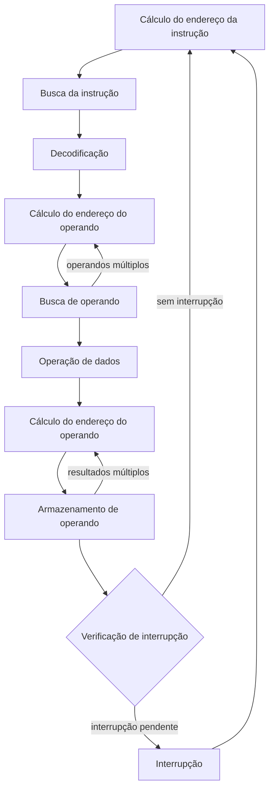

# Interrupções e Entrada/Saída (Microprocessador III)

← [[09 - Processador e Datapath RISC-V (Microprocessador I)]] | [[00 - Índice - Organização de Computadores|Índice]] | Próxima: [[08 - Exercícios - Microprocessador III (Interrupções e E-S)]]

Esta é a nota de teoria do deck Microprocessador III, a última aula do curso. Os exercícios do slide 17, com as respostas comparando as técnicas, estão em [[08 - Exercícios - Microprocessador III (Interrupções e E-S)]]. Na prova, esta nota corresponde ao tópico 6 (Entrada e saída: interrupção, tipos de E/S, DMA) e também à parte do tópico 4 sobre o ciclo de busca e execução.

## 1. Onde estamos no curso (slides 2-5)

O slide 2 repete o diagrama von Neumann e diz que, nesta última aula, o objetivo é analisar o funcionamento do computador inteiro, incluindo entradas e saídas. O slide 3 ("Aulas passadas") repete o datapath básico do RISC-V, o mesmo do slide 17 do Microprocessador I (ver [[09 - Processador e Datapath RISC-V (Microprocessador I)#9. Datapath básico completo (slide 17)]]).

Resumo das aulas anteriores, segundo o slide 5:

1. Como o código em alto nível vira instruções e é executado (Assembly).
2. Como as operações são feitas pela ULA.
3. Microarquitetura de um processador RISC-V de ciclo único.
4. Microarquitetura de um processador RISC-V pipeline.

O item 1 está no Microprocessador I, e o item 3 está no Microprocessador I mais o deck de ciclo único (ver [[09 - Processador e Datapath RISC-V (Microprocessador I)]]). A aula da ULA (item 2) e a de pipeline (item 4) não estão neste vault. A pergunta que abre o resto da aula é: **como o processador interage com módulos externos?**

## 2. Ciclo de busca e execução detalhado (slide 4)

A versão curta do ciclo é **Busca → Decodificação → Execução → Armazenamento**. O slide 4 mostra a versão detalhada (a figura parece ser do livro do Stallings), com estes estados:

1. Cálculo do endereço da instrução
2. Busca da instrução
3. Decodificação do operando da instrução (é aqui que a instrução é decodificada)
4. Cálculo do endereço do operando
5. Busca de operando, com laço de volta para o passo 4 quando há **operandos múltiplos**
6. Operação de dados
7. Cálculo do endereço do operando (agora do resultado)
8. Armazenamento de operando, com laço de volta para o passo 7 quando há **resultados múltiplos**

Depois do armazenamento há dois caminhos de volta: "Fim da execução da instrução e busca da instrução seguinte" (volta ao passo 1) ou "Retorna uma cadeia de caracteres (string) ou vetor de dados" (volta ao passo 4, para operar o próximo elemento).

> [!tip] Ligando com a versão curta
> Passos 1 e 2 = busca. Passo 3 = decodificação. Passos 4 a 6 = execução (buscar os operandos e operar). Passos 7 e 8 = armazenamento. A ligação é minha, o slide não faz esse mapeamento.

## 3. Interrupção (slide 6)

Interrupções são **eventos especiais que interrompem o processamento normal do ciclo de busca e execução**. O pedido costuma chegar por um sinal de controle, o **IRQ (Interrupt Request)**.

| Tipo | Gerada por |
|---|---|
| Programa | Alguma condição que ocorre como resultado da execução de uma instrução: overflow aritmético, divisão por zero, tentativa de executar instrução de máquina ilegal, referência fora do espaço de memória permitido ao usuário |
| Timer | Um timer dentro do processador. Permite ao sistema operacional realizar certas funções regularmente |
| E/S | Um controlador de E/S, para sinalizar o término normal de uma operação ou uma série de condições de erro |
| Falha de hardware | Uma falha como falta de energia ou erro de paridade de memória |

> [!warning] Ajuste em relação ao slide
> Na linha do Timer, o slide diz "um timer dentro do **processo**". Pelo contexto deve ser "processador".

## 4. Fluxo de controle de interrupção (slide 7)

O slide compara três situações, usando um programa do usuário que faz dois `WRITE` e um programa de E/S que atende cada `WRITE`:

- **(a) Sem interrupções**: no `WRITE`, o programa de E/S prepara a operação (segmento 4), manda o comando e fica esperando o dispositivo até o `END` (segmento 5). O programa do usuário fica parado esse tempo todo.
- **(b) Com interrupções, espera curta de E/S**: o programa de E/S só prepara e envia o comando (segmento 4) e devolve o controle. O programa do usuário continua (segmentos 2a e 2b). Quando o dispositivo termina, ele interrompe o programa (o "X") e o tratador de interrupção (segmento 5) finaliza a operação.
- **(c) Com interrupções, espera longa de E/S**: o programa chega no segundo `WRITE` antes de o primeiro terminar e precisa esperar mesmo assim, mas parte do tempo de E/S já foi aproveitada.

O título do slide diz que "a interrupção pode interromper o ciclo de busca no meio". Pela figura e pelo slide 10, a interrupção é verificada **no fim de cada instrução**, então o "meio" é o meio do programa do usuário, entre duas instruções. Mais detalhes em [[08 - Exercícios - Microprocessador III (Interrupções e E-S)#2. Ciclo de busca e execução com e sem interrupção]].

## 5. Transferência de controle via interrupção (slide 8)

Quando ocorre uma interrupção, o processador:

1. **Suspende o programa** em execução e **salva o contexto**: o endereço da próxima instrução (o conteúdo atual do PC) e quaisquer outros dados relevantes para a atividade atual.
2. **Carrega no PC o endereço inicial da rotina de tratamento de interrupção**.

O slide tem duas figuras:

- **Programa do usuário e tratador**: o programa executa as instruções 1, 2, ..., i. A marca "Interrupção ocorre aqui" fica entre a instrução i e a i + 1. O controle passa para o tratador de interrupção e, quando ele termina, volta para a instrução i + 1. A volta (restaurar o contexto) aparece só na figura, não no texto.
- **Ciclo de instrução com interrupções**: INICIAR → ciclo de busca (buscar próxima instrução) → ciclo de execução (executar instrução) → ciclo de interrupções (verificar interrupção; processar interrupção) → volta para a busca. Se as **interrupções estiverem desabilitadas**, a execução volta direto para a busca, sem passar pela verificação. Do ciclo de execução também sai o caminho para PARAR.

## 6. Múltiplas interrupções (slide 9)

Podem acontecer **interrupções aninhadas**: uma rotina de tratamento é interrompida por outra de prioridade maior. Linha do tempo da figura:

| Tempo | Evento |
|---|---|
| t = 0 | Programa do usuário começa |
| t = 10 | A impressora interrompe o programa do usuário |
| t = 15 | A comunicação interrompe a rotina da impressora |
| t = 25 | A rotina de comunicação termina; a rotina do disco é atendida antes de a impressora voltar |
| t = 35 | A rotina do disco termina; a rotina da impressora continua |
| t = 40 | A rotina da impressora termina; volta ao programa do usuário |

Pela figura, comunicação e disco têm prioridade maior que a impressora.

## 7. Ciclo de busca com interrupção (slide 10)

É o ciclo do slide 4 com dois estados novos no final:

Depois de armazenar o resultado, o processador **verifica se há interrupção**. Se não houver, segue para a próxima instrução. Se houver, entra no estado "Interrupção" (salva contexto e carrega o endereço do tratador, seção 5) e o próximo ciclo já busca a primeira instrução da rotina de tratamento. O diagrama acima simplifica o desenho do slide; o laço "string ou vetor de dados" foi omitido.

## 8. Módulo de Entrada/Saída (slides 11-12)

O módulo de E/S fica entre o barramento do sistema e os periféricos. No diagrama do slide 11, ele se liga às três linhas do barramento (endereço, dados e controle, ver seção 2 de [[02 - Barramentos (Buses)]]) e, do outro lado, às conexões para dispositivos periféricos.

Responsabilidades do módulo, segundo o slide:

- Controle e temporização
- Comunicação com o processador
- Comunicação com o dispositivo externo
- **Buffering de dados**
- Detecção de erro

Como o processador lê um dado de um dispositivo (slide 12):

1. O processador interroga o módulo de E/S para verificar o estado do dispositivo.
2. O módulo de E/S retorna o estado.
3. Se o dispositivo estiver operacional e pronto, o processador pede a transferência com um comando ao módulo.
4. O módulo obtém uma unidade de dados (por exemplo, 8 ou 16 bits) do dispositivo externo.
5. Os dados são transferidos do módulo para o processador.

## 9. Três formas de acesso a E/S (slides 13-14)

| Técnica | Como funciona (slide 13) | Exemplo do slide |
|---|---|---|
| **E/S programada** | Sem interrupção: o processador fica verificando a E/S constantemente até ela ficar pronta. Problema: perda de tempo | Sensor simples |
| **E/S controlada por interrupção** | O processador envia o comando e continua operando até ser interrompido | Teclado e mouse |
| **DMA (Direct Memory Access)** | O módulo de E/S e a memória principal trocam dados diretamente, sem envolver o processador | Placa de vídeo, disco |

O slide 14 mostra cada técnica lendo um bloco de dados:

- **(a) Programada**: CPU envia o comando de leitura (CPU → E/S), lê o registrador de estado (E/S → CPU) e fica no laço "verifica o estado" até ficar pronto. Aí lê a palavra (E/S → CPU), grava na memória (CPU → memória) e repete até terminar o bloco.
- **(b) Por interrupção**: CPU envia o comando e "faz algo mais". Quando chega a interrupção, lê o estado, lê a palavra e grava na memória. Repete para cada palavra.
- **(c) DMA**: CPU envia o comando ao DMA (CPU → DMA) e "faz algo mais". Só no fim do bloco chega uma interrupção, a CPU lê o estado (DMA → CPU) e segue para a próxima instrução.

As vantagens e desvantagens de cada uma estão na tabela comparativa do exercício 3 em [[08 - Exercícios - Microprocessador III (Interrupções e E-S)]].

## 10. DMA e cycle stealing (slide 15)

O DMA **rouba um ciclo do processador** para transferir dados pelo barramento e, quando termina o bloco, **gera uma interrupção**.

A figura divide um ciclo de instrução em ciclos do processador: busca da instrução, decodificação, busca do operando, execução, armazenamento do resultado e processamento da interrupção. Os **pontos de parada de DMA** ficam nas divisões entre esses ciclos, dentro da instrução (as setas apontam, por exemplo, para a divisão entre a decodificação e a busca do operando e para a divisão entre a execução e o armazenamento). O **ponto de interrupção** fica só depois do armazenamento do resultado, no fim da instrução.

> [!tip] Diferença que costuma cair
> O DMA pode pausar a CPU no meio de uma instrução, porque só precisa do barramento por um ciclo e não troca de contexto. A interrupção só é atendida no fim da instrução, porque exige salvar o contexto e desviar para outra rotina.

## 11. Conclusão (slide 16)

O slide de conclusão traz só um link: [emulsiV](https://eseo-tech.github.io/emulsiV/). Não consegui abrir o site para conferir. Pelo que sei, é um simulador visual de um processador RISC-V simples, que roda no navegador e mostra o caminho dos dados a cada instrução. Vale abrir e testar `add`, `lw` e `beq` vendo o datapath da [[09 - Processador e Datapath RISC-V (Microprocessador I)|nota 09]] funcionando.

## 12. Exercícios (slide 17)

1. Por que existem interrupções? Quais os tipos de interrupção?
2. Compare o ciclo de busca e execução com e sem a presença de interrupção.
3. Quais os tipos de acesso a entrada e saída? Compare as vantagens e desvantagens de cada uma delas.

Soluções sugeridas em [[08 - Exercícios - Microprocessador III (Interrupções e E-S)]].

## Referências (do slide 18)

- David Patterson e John Hennessy. *Computer Organization and Design RISC-V Edition: The Hardware Software Interface*. Morgan Kaufmann, 2018.
- William Stallings. *Arquitetura e organização de computadores*. Pearson, 2017.
- Sarah Harris e David Harris. *Digital design e computer architecture*. Morgan Kaufmann, 2015.
