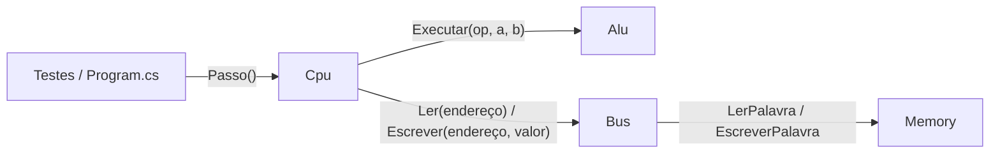

# Simulador RISC-V: Visão Geral do Código

← [[00 - Índice - Organização de Computadores|Índice da disciplina]] | Próxima: [[Sim 01 - Solução e Projetos (csproj)]]

Esta pasta explica o código do simulador do projeto final, arquivo por arquivo e função por função. As notas descrevem o código **como ele estava na pasta `SimuladorRiscV` em 08/11/2026**. Quando o código mudar (por exemplo, quando entrarem `lw`, `sw` e os desvios), as notas precisam mudar junto.

> [!info] Como ler estas notas
> Cada nota de arquivo segue a mesma ordem: para que o arquivo serve, depois cada constante, campo e função, com o trecho de código, o que ele faz e por que foi escrito assim. No fim vem a ligação com a matéria e as limitações conhecidas.
> Os recursos da linguagem C# que aparecem no código (`>>>`, `switch` de expressão, construtor primário etc.) estão explicados em [[Sim 10 - Conceitos de CSharp Usados no Código]].

## 1. O que o simulador faz

O programa imita um computador simples com processador **RISC-V RV32I de ciclo único**. Ele tem:

- uma **memória** de 640 KB dividida no mapa do enunciado (RAM, VRAM, área reservada e E/S);
- um **barramento** que liga a CPU à memória, com linhas de endereço, dados e controle;
- uma **ULA** que faz as 10 operações do RV32I;
- uma **CPU** que busca uma instrução na memória, decodifica, executa e guarda o resultado, uma instrução por vez.

Um programa RISC-V em binário fica na memória a partir do endereço 0. A cada chamada de `Cpu.Passo()`, uma instrução é executada inteira. Isso é o ciclo de busca e execução da aula, só que escrito em C#.

## 2. Estrutura da solução

```
SimuladorRiscV/
├── SimuladorRiscV.slnx          ← solução (junta os 3 projetos)
├── Simulator.core/              ← biblioteca: o "hardware" simulado
│   ├── Memory.cs                ← memória + mapa de endereços + exceção
│   ├── Bus.cs                   ← barramento
│   ├── Alu.cs                   ← ULA
│   └── Cpu.cs                   ← processador
├── Simulator.test/              ← testes automáticos (xUnit)
│   ├── Montador.cs              ← gera instruções em binário para os testes
│   ├── MemoriaTeste.cs          ← testes da memória
│   └── CpuTests.cs              ← testes da CPU
└── Simulador/                   ← aplicativo de console
    └── Program.cs               ← ainda é o "Hello, World!" do modelo
```

## 3. Notas desta pasta

| Nota | Arquivo(s) | Bloco do enunciado |
|---|---|---|
| [[Sim 01 - Solução e Projetos (csproj)]] | `.slnx` e os três `.csproj` | organização do projeto |
| [[Sim 02 - Memory (Memória)]] | `Memory.cs` | Memória RAM (2 pts) |
| [[Sim 03 - Bus (Barramento)]] | `Bus.cs` | Barramento (1 pt) |
| [[Sim 04 - Alu (ULA)]] | `Alu.cs` | parte da CPU |
| [[Sim 05 - Cpu (Processador)]] | `Cpu.cs` | CPU (3 pts) |
| [[Sim 06 - Rastreio de uma Instrução Bit a Bit]] | `Cpu.cs` na prática | CPU |
| [[Sim 07 - Montador (Gerador de Instruções)]] | `Montador.cs` | apoio aos testes |
| [[Sim 08 - Testes (MemoriaTeste e CpuTests)]] | `MemoriaTeste.cs`, `CpuTests.cs` | apoio |
| [[Sim 09 - Program (Aplicativo de Console)]] | `Program.cs` | E/S programada e programa de teste (futuro) |
| [[Sim 10 - Conceitos de CSharp Usados no Código]] | todos | glossário da linguagem |

## 4. Como as peças se conectam



Repare em duas regras que vêm direto da arquitetura von Neumann ([[01 - Arquitetura von Neumann e Estrutura do Computador]]):

1. **Programa e dados ficam na mesma memória.** As instruções são números de 32 bits guardados na RAM, igual a qualquer dado.
2. **A CPU nunca mexe na memória diretamente.** A classe `Cpu` só conhece o `Bus`. Toda leitura de instrução e todo acesso a dado passam pelo barramento, que por sua vez chama a `Memory`.

## 5. O caminho de uma instrução (resumo)

1. `Cpu.Passo()` chama `Bus.Ler(Pc)`. O barramento coloca o PC na linha de endereços, marca o sinal de controle como **Leitura** e devolve a palavra que estava na memória. Essa palavra é a instrução. (**Busca**)
2. A CPU separa os campos da instrução (`opcode`, `rd`, `funct3`, `rs1`, `rs2`, `funct7`) usando deslocamento e máscara de bits. (**Decodificação**)
3. Pelo `opcode` e pelos `funct`, a CPU escolhe a operação e chama `Alu.Executar`. (**Execução**)
4. O resultado vai para o registrador `rd`, a não ser que `rd` seja `x0`. (**Armazenamento**)
5. O PC avança 4 bytes para a próxima instrução.

O detalhe de cada passo está em [[Sim 05 - Cpu (Processador)]], e um exemplo com os bits de verdade está em [[Sim 06 - Rastreio de uma Instrução Bit a Bit]].

## 6. Onde cada conceito da aula aparece no código

| Conceito da matéria | Onde está no código | Nota da disciplina |
|---|---|---|
| Barramento de endereços, dados e controle | propriedades `Enderecos`, `Dados`, `SinalControle` de `Bus` | [[02 - Barramentos (Buses)]] |
| Mapa de memória | constantes de `Memory` e `Memory.Regiao` | [[03 - Hierarquia e Tipos de Memória]] |
| Banco de 32 registradores, `x0` sempre zero | `_x` e `EscreverReg` em `Cpu` | [[09 - Processador e Datapath RISC-V (Microprocessador I)]] |
| Ciclo de busca e execução | `Cpu.Passo()` | [[10 - Interrupções e Entrada-Saída (Microprocessador III)#2. Ciclo de busca e execução detalhado (slide 4)\|nota 10, seção 2]] |
| Controle da ULA (opcode + funct3 + funct7) | `switch` dentro de `Passo()` | [[09 - Processador e Datapath RISC-V (Microprocessador I)#10.2 Controle da ULA (slide 13)\|nota 09, seção 10.2]] |
| Flag Zero da ULA | `Alu.Zero` (ainda sem uso; vai servir para `beq`) | [[09 - Processador e Datapath RISC-V (Microprocessador I)#10.5 PCSrc = Branch AND Zero (slide 17)\|nota 09, seção 10.5]] |
| Linha de pedido de interrupção | `Bus.Irq`, `PedirInterrupcao`, `LimparInterrupcao` | [[10 - Interrupções e Entrada-Saída (Microprocessador III)#3. Interrupção (slide 6)\|nota 10, seção 3]] |

## 7. Estado atual: o que está pronto e o que falta

**Pronto no código (08/11/2026):**

- Mapa de memória do enunciado, little-endian, com bloqueio de escrita na área reservada e de acesso desalinhado.
- Barramento com as três linhas, contadores de leituras e escritas e a linha de IRQ.
- ULA com `add`, `sub`, `sll`, `slt`, `sltu`, `xor`, `srl`, `sra`, `or`, `and`.
- CPU executando as 10 instruções do tipo R, as 9 do tipo I e `ecall`/`ebreak` (fim do programa).
- Montador de testes e 12 testes automáticos (8 da memória, 4 da CPU).

**Ainda falta:**

- [ ] `lw`, `sw` e os 6 desvios (`beq`, `bne`, `blt`, `bge`, `bltu`, `bgeu`). O código da etapa 3 já foi passado no chat, mas ainda não está no `Cpu.cs` nem no `Montador.cs` desta pasta.
- [ ] A instrução especial do grupo (depende do número do grupo, que ainda precisa ser confirmado com o professor).
- [ ] Tratamento de interrupção na CPU. A linha `Irq` existe no barramento, mas a CPU ainda não verifica essa linha no fim de cada instrução.
- [ ] E/S programada: mostrar o conteúdo da VRAM no terminal a cada N instruções.
- [ ] `Program.cs` de verdade (hoje é só o "Hello, World!" do modelo do Visual Studio).
- [ ] Programa de teste, documentação e repositório público.

> [!warning] Constantes declaradas mas ainda sem uso
> `Cpu.cs` já declara `OpLoad`, `OpStore` e `OpBranch`, mas nenhum `case` trata esses opcodes. Hoje, se aparecer um `lw` no programa, a CPU lança "Instrução desconhecida". Isso é esperado até a etapa 3 ser colada.
