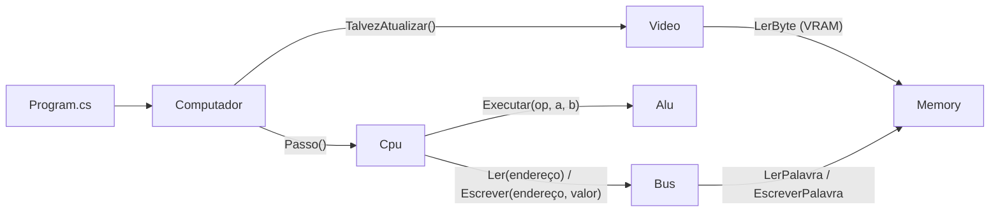

# Simulador RISC-V: Visão Geral do Código

← [[00 - Índice - Organização de Computadores|Índice da disciplina]] | Próxima: [[Sim 01 - Solução e Projetos (csproj)]]

Esta pasta explica o código do simulador do projeto final, arquivo por arquivo e função por função. As notas descrevem o código **como ele estava na pasta `SimuladorRiscV` em 11/11/2026**, depois da etapa 4 (aplicativo de console e E/S programada). Quando o código mudar de novo, as notas precisam mudar junto.

> [!info] Como ler estas notas
> Cada nota de arquivo segue a mesma ordem: para que o arquivo serve, depois cada constante, campo e função, com o trecho de código, o que ele faz e por que foi escrito assim. No fim vem a ligação com a matéria e as limitações conhecidas.
> Os recursos da linguagem C# que aparecem no código (`>>>`, `switch` de expressão, construtor primário etc.) estão explicados em [[Sim 10 - Conceitos de CSharp Usados no Código]].

## 1. O que o simulador faz

O programa imita um computador simples com processador **RISC-V RV32I de ciclo único**. Ele tem:

- uma **memória** de 640 KB dividida no mapa do enunciado (RAM, VRAM, área reservada e E/S);
- um **barramento** que liga a CPU à memória, com linhas de endereço, dados e controle;
- uma **ULA** que faz as 10 operações do RV32I e o POPCNT;
- uma **CPU** que busca uma instrução na memória, decodifica, executa e guarda o resultado, uma instrução por vez;
- uma **tela de texto** ligada à VRAM, mostrada no terminal a cada N instruções (a E/S programada).

Um programa RISC-V em binário fica na memória a partir do endereço 0. A cada chamada de `Cpu.Passo()`, uma instrução é executada inteira. Isso é o ciclo de busca e execução da aula, só que escrito em C#.

A CPU já executa todas as instruções que o enunciado exige (tipo R, tipo I, `lw`, `sw` e os 6 desvios) e a instrução especial do grupo 4, o **POPCNT** (`cpop` na extensão Zbb).

## 2. Estrutura da solução

```
SimuladorRiscV/
├── SimuladorRiscV.slnx          ← solução (junta os 3 projetos)
├── Simulator.core/              ← biblioteca: o "hardware" simulado
│   ├── Memory.cs                ← memória + mapa de endereços + exceção
│   ├── Bus.cs                   ← barramento
│   ├── Alu.cs                   ← ULA
│   ├── Cpu.cs                   ← processador
│   ├── Video.cs                 ← tela da VRAM (E/S programada)
│   ├── Computador.cs            ← junta as peças, carrega .hex e executa
│   └── ProgramaDemo.cs          ← programa de demonstração (em .hex)
├── Simulator.test/              ← testes automáticos (xUnit)
│   ├── Montador.cs              ← gera instruções em binário para os testes
│   ├── MemoriaTeste.cs          ← testes da memória
│   ├── CpuTests.cs              ← testes das instruções tipo R e tipo I
│   ├── MemoriaEDesviosTests.cs  ← testes de lw, sw, VRAM e desvios
│   ├── PopcntTests.cs           ← testes do POPCNT (instrução do grupo 4)
│   └── ComputadorTests.cs       ← testes do .hex, da tela e da execução completa
├── Simulador/                   ← aplicativo de console
│   └── Program.cs               ← opções, carga, execução e relatório
└── exemplos/
    └── demo.hex                 ← o programa de demonstração como arquivo
```

## 3. Notas desta pasta

| Nota | Arquivo(s) | Bloco do enunciado |
|---|---|---|
| [[Sim 01 - Solução e Projetos (csproj)]] | `.slnx` e os três `.csproj` | organização do projeto |
| [[Sim 02 - Memory (Memória)]] | `Memory.cs` | Memória RAM (2 pts) |
| [[Sim 03 - Bus (Barramento)]] | `Bus.cs` | Barramento (1 pt) |
| [[Sim 04 - Alu (ULA)]] | `Alu.cs` | parte da CPU (inclui o POPCNT) |
| [[Sim 05 - Cpu (Processador)]] | `Cpu.cs` | CPU (3 pts) |
| [[Sim 14 - Opcodes e Famílias de Instruções]] | `Cpu.cs` (opcodes e formatos) | CPU |
| [[Sim 06 - Rastreio de uma Instrução Bit a Bit]] | `Cpu.cs` na prática | CPU |
| [[Sim 07 - Montador (Gerador de Instruções)]] | `Montador.cs` | apoio aos testes |
| [[Sim 08 - Testes (MemoriaTeste e CpuTests)]] | os 5 arquivos de teste | apoio |
| [[Sim 09 - Program (Aplicativo de Console)]] | `Program.cs` | aplicativo e E/S programada (2 pts) |
| [[Sim 11 - Video (E-S Programada)]] | `Video.cs` | E/S programada (2 pts) |
| [[Sim 12 - Computador (Carregar e Executar)]] | `Computador.cs` | carregador e laço principal |
| [[Sim 13 - Programa de Demonstração]] | `ProgramaDemo.cs`, `exemplos/demo.hex` | demonstração em Assembly |
| [[Sim 10 - Conceitos de CSharp Usados no Código]] | todos | glossário da linguagem |

## 4. Como as peças se conectam



Repare em duas regras que vêm direto da arquitetura von Neumann ([[01 - Arquitetura von Neumann e Estrutura do Computador]]):

1. **Programa e dados ficam na mesma memória.** As instruções são números de 32 bits guardados na RAM, igual a qualquer dado.
2. **A CPU nunca mexe na memória diretamente.** A classe `Cpu` só conhece o `Bus`. Toda leitura de instrução e todo acesso a dado passam pelo barramento, que por sua vez chama a `Memory`.

A tela (`Video`) é a única peça que lê a memória sem passar pelo barramento, como o controlador de vídeo de um computador real, que tem acesso próprio à memória de vídeo.

## 5. O caminho de uma instrução (resumo)

1. `Cpu.Passo()` chama `Bus.Ler(Pc)`. O barramento coloca o PC na linha de endereços, marca o sinal de controle como **Leitura** e devolve a palavra que estava na memória. Essa palavra é a instrução. (**Busca**)
2. A CPU separa os campos da instrução (`opcode`, `rd`, `funct3`, `rs1`, `rs2`, `funct7`) usando deslocamento e máscara de bits, e monta o imediato. (**Decodificação**)
3. Pelo `opcode` e pelos `funct`, a CPU escolhe a operação e chama `Alu.Executar`. No `lw` e no `sw`, a ULA calcula o endereço. Nos desvios, ela compara os dois registradores. (**Execução**)
4. Só no `lw` e no `sw`: a CPU usa o barramento de novo, para ler ou gravar o dado. (**Acesso à memória**)
5. O resultado vai para o registrador `rd`, a não ser que `rd` seja `x0`. `sw` e desvios não escrevem em registrador. (**Armazenamento**)
6. O PC avança 4 bytes. Num desvio tomado, ele pula para `PC + deslocamento`.

O detalhe de cada passo está em [[Sim 05 - Cpu (Processador)]], e um exemplo com os bits de verdade está em [[Sim 06 - Rastreio de uma Instrução Bit a Bit]].

## 6. Onde cada conceito da aula aparece no código

| Conceito da matéria | Onde está no código | Nota da disciplina |
|---|---|---|
| Barramento de endereços, dados e controle | propriedades `Enderecos`, `Dados`, `SinalControle` de `Bus` | [[02 - Barramentos (Buses)]] |
| Mapa de memória | constantes de `Memory` e `Memory.Regiao` | [[03 - Hierarquia e Tipos de Memória]] |
| Banco de 32 registradores, `x0` sempre zero | `_x` e `EscreverReg` em `Cpu` | [[09 - Processador e Datapath RISC-V (Microprocessador I)]] |
| Ciclo de busca e execução | `Cpu.Passo()` | [[10 - Interrupções e Entrada-Saída (Microprocessador III)#2. Ciclo de busca e execução detalhado (slide 4)\|nota 10, seção 2]] |
| Controle da ULA (opcode + funct3 + funct7) | `switch` dentro de `Passo()` | [[09 - Processador e Datapath RISC-V (Microprocessador I)#10.2 Controle da ULA (slide 13)\|nota 09, seção 10.2]] |
| Flag Zero da ULA | `Alu.Zero`, usada por `beq` e `bne` | [[09 - Processador e Datapath RISC-V (Microprocessador I)#10.5 PCSrc = Branch AND Zero (slide 17)\|nota 09, seção 10.5]] |
| Acesso à memória (`lw`/`sw`) | `case OpLoad` e `case OpStore` em `Passo()` | [[09 - Processador e Datapath RISC-V (Microprocessador I)\|nota 09]], seções 8.3 e 11.2 |
| Desvio e multiplexador `PCSrc` | `case OpBranch` em `Passo()` | [[09 - Processador e Datapath RISC-V (Microprocessador I)\|nota 09]], seções 8.4 e 11.3 |
| E/S programada e E/S mapeada em memória | `sw` na VRAM + `Video` | [[10 - Interrupções e Entrada-Saída (Microprocessador III)\|nota 10]], seção 9 |
| Linha de pedido de interrupção | `Bus.Irq`, `PedirInterrupcao`, `LimparInterrupcao` | [[10 - Interrupções e Entrada-Saída (Microprocessador III)#3. Interrupção (slide 6)\|nota 10, seção 3]] |

## 7. Estado atual: o que está pronto e o que falta

**Pronto no código (11/11/2026):**

- Mapa de memória do enunciado, little-endian, com bloqueio de escrita na área reservada e de acesso desalinhado.
- Barramento com as três linhas, contadores de leituras e escritas e a linha de IRQ.
- ULA com `add`, `sub`, `sll`, `slt`, `sltu`, `xor`, `srl`, `sra`, `or`, `and` e o POPCNT.
- CPU executando as 10 instruções do tipo R, as 9 do tipo I, `lw`, `sw`, os 6 desvios e `ecall`/`ebreak` (fim do programa).
- Instrução especial do grupo 4: **POPCNT**, com a codificação oficial do `cpop` da extensão Zbb.
- E/S programada: o programa escreve na VRAM com `sw`, e a tela é conferida a cada N instruções e impressa no terminal quando muda.
- Aplicativo de console com leitura de `.hex`, modo passo a passo, limite de instruções e relatório final.
- Programa de demonstração que usa tudo isso, incluindo o POPCNT.
- Montador de testes com rótulos e 37 testes automáticos.

**Ainda falta:**

- [ ] Tratamento de interrupção na CPU. A linha `Irq` existe no barramento, mas a CPU ainda não verifica essa linha no fim de cada instrução.
- [ ] Programa de teste final (o enunciado sugere escrever em C e compilar no godbolt.org). Para isso, `lui` e `jal`/`jalr` fariam muita falta: compiladores usam essas instruções o tempo todo.
- [ ] Documentação e repositório público do projeto.
