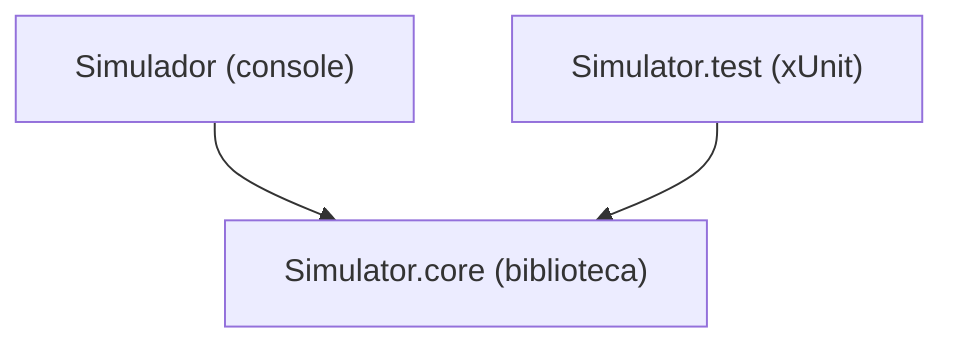

# Solução e Projetos (csproj)

← [[Sim 00 - Visão Geral do Simulador|Visão geral]] | Próxima: [[Sim 02 - Memory (Memória)]]

Antes do código em si, vale entender como o Visual Studio organiza tudo. Uma **solução** é um agrupador de **projetos**. Cada projeto vira um programa ou uma biblioteca separada quando compila.

## 1. `SimuladorRiscV.slnx` (a solução)

```xml
<Solution>
  <Project Path="Simulador/Simulador.csproj" />
  <Project Path="Simulator.core/Simulator.core.csproj" />
  <Project Path="Simulator.test/Simulator.test.csproj" />
</Solution>
```

Só lista os três projetos e onde cada um está. É o arquivo que você abre no Visual Studio para carregar tudo de uma vez.

O `.slnx` é o formato novo de solução, em XML simples. Ele substitui o `.sln` antigo, que tinha um formato de texto bem mais confuso. Não tenho certeza de qual versão exata do Visual Studio passou a criar `.slnx` por padrão, mas para você não muda nada no dia a dia.

## 2. Os três projetos e quem depende de quem



| Projeto | Tipo | Para que serve |
|---|---|---|
| `Simulator.core` | biblioteca de classes | o "hardware": memória, barramento, ULA, CPU |
| `Simulator.test` | projeto de testes xUnit | confere automaticamente se cada parte funciona |
| `Simulador` | aplicativo de console (`.exe`) | o programa que você vai rodar e mostrar na apresentação |

A biblioteca não depende de ninguém. O aplicativo e os testes dependem dela. Essa separação é útil porque o mesmo código da CPU é usado nos testes e no programa final, sem copiar nada.

## 3. `Simulator.core.csproj`

```xml
<Project Sdk="Microsoft.NET.Sdk">
  <PropertyGroup>
    <TargetFramework>net10.0</TargetFramework>
    <ImplicitUsings>enable</ImplicitUsings>
    <Nullable>enable</Nullable>
  </PropertyGroup>
</Project>
```

- **`Sdk="Microsoft.NET.Sdk"`**: diz que é um projeto .NET comum.
- **`TargetFramework` = `net10.0`**: o projeto compila para o .NET 10. A versão da linguagem C# vem junto com essa escolha, e é por isso que recursos novos como o operador `>>>` e o construtor primário funcionam.
- **`ImplicitUsings`**: o compilador coloca sozinho alguns `using` comuns em todos os arquivos (como `System` e `System.Collections.Generic`). Por isso o código usa `Exception`, `List<int>` e `Array` sem escrever `using System;` no topo.
- **`Nullable`**: liga os avisos de valor nulo. O compilador avisa quando uma variável pode ficar `null` sem você tratar.
- Não tem `OutputType`, então o padrão é **biblioteca** (gera uma `.dll`, não um `.exe`).

## 4. `Simulador.csproj` (aplicativo)

```xml
<OutputType>Exe</OutputType>
...
<ProjectReference Include="..\Simulator.core\Simulator.core.csproj" />
```

- **`OutputType` = `Exe`**: gera um executável de console.
- **`ProjectReference`**: liga o aplicativo à biblioteca. Sem essa linha, o `Program.cs` não enxergaria as classes `Cpu`, `Bus` etc.

## 5. `Simulator.test.csproj` (testes)

```xml
<IsPackable>false</IsPackable>
...
<PackageReference Include="coverlet.collector" Version="6.0.4" />
<PackageReference Include="Microsoft.NET.Test.Sdk" Version="17.14.1" />
<PackageReference Include="xunit" Version="2.9.3" />
<PackageReference Include="xunit.runner.visualstudio" Version="3.1.4" />
...
<ProjectReference Include="..\Simulator.core\Simulator.core.csproj" />
...
<Using Include="Xunit" />
```

| Linha | O que faz |
|---|---|
| `IsPackable` = `false` | impede que o projeto de testes seja empacotado como pacote NuGet (não faz sentido publicar testes) |
| `xunit` | a biblioteca de testes: traz `[Fact]`, `[Theory]`, `Assert` |
| `xunit.runner.visualstudio` | deixa o Gerenciador de Testes do Visual Studio encontrar e rodar os testes |
| `Microsoft.NET.Test.Sdk` | a infraestrutura que executa os testes (também usada pelo `dotnet test` no terminal) |
| `coverlet.collector` | mede cobertura de código (quais linhas os testes executaram). Veio no modelo e não é obrigatório |
| `ProjectReference` | liga os testes à biblioteca `Simulator.core` |
| `<Using Include="Xunit" />` | cria um `using Xunit;` global. Por isso os arquivos de teste usam `[Fact]` e `Assert` sem importar nada |

## 6. Nome da pasta e nome do namespace

As pastas se chamam `Simulator.core` e `Simulator.test`, mas o código declara `namespace Simulador.Core;` e `namespace Simulador.Tests;`. Isso funciona sem problema: em C#, o namespace é o que está escrito no arquivo, não o nome da pasta ou do projeto.

> [!tip] Opcional
> Se quiser deixar tudo com o mesmo nome (por exemplo, para a documentação do repositório ficar mais limpa), dá para renomear os projetos depois. Não muda nada no funcionamento.

## 7. Pastas `bin` e `obj`

Cada projeto tem `bin/` e `obj/`. São arquivos gerados na compilação. Não edite nada lá dentro e não envie essas pastas para o repositório público (elas entram no `.gitignore`).
