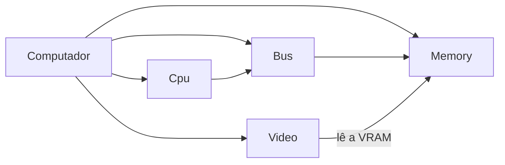

# Computador.cs: montar a máquina, carregar e executar

← [[Sim 11 - Video (E-S Programada)]] | [[Sim 00 - Visão Geral do Simulador|Visão geral]] | Próxima: [[Sim 13 - Programa de Demonstração]]

## 1. Para que serve

A `Computador` junta todas as peças numa máquina pronta para usar, e faz as três coisas que o aplicativo precisa:

1. **montar** o computador (memória, barramento, CPU e vídeo, ligados entre si);
2. **carregar** um programa na memória, inclusive a partir de um arquivo `.hex`;
3. **executar** o programa até o fim, atualizando a tela.

Antes dela, os testes montavam o computador "na mão" (no `Montador.Rodar`). Agora o `Program.cs` e os testes novos usam a mesma classe.



## 2. Propriedades e construtor

```csharp
public Memory Memoria { get; } = new();
public Bus Barramento { get; }
public Cpu Cpu { get; }
public Video Video { get; }

public Computador(int intervaloVideo)
{
    Barramento = new Bus(Memoria);
    Cpu = new Cpu(Barramento);
    Video = new Video(Memoria, intervaloVideo);
}
```

A ordem de criação segue a dependência entre as peças: primeiro a memória, depois o barramento ligado a ela, depois a CPU ligada ao barramento. O vídeo recebe a memória direto, porque ele lê a VRAM por conta própria (ver [[Sim 11 - Video (E-S Programada)]]).

As propriedades só têm `get`: depois de criado, o computador não troca de peça. Mas de fora dá para chegar em todas elas, por exemplo `computador.Cpu[10]` para ler o `a0`, ou `computador.Barramento.Leituras`.

`intervaloVideo` é o N da E/S programada. Com 0, a tela fica desligada, o que os testes usam bastante.

## 3. `Carregar(int endereco, int[] codigo)`

```csharp
public void Carregar(int endereco, int[] codigo)
{
    for (int k = 0; k < codigo.Length; k++)
        Memoria.EscreverPalavra(endereco + 4 * k, codigo[k]);
}
```

Copia as instruções para a memória, uma palavra a cada 4 bytes, a partir do endereço indicado. É o papel do **carregador** (*loader*), a última etapa entre o programa compilado e a execução.

**Por que escreve direto na memória, e não pelo barramento.** Assim os contadores do barramento mostram só o que **o programa** fez durante a execução. No `Montador.Rodar` dos testes antigos, a carga passava pelo barramento e entrava na contagem de escritas. Num computador real, quem carrega o programa costuma ser o sistema operacional ou uma rotina de inicialização, e não o próprio programa.

O método **não mexe no PC**. A CPU já começa com `PC = 0` quando é criada. Isso permite, na etapa de interrupções, carregar mais de um trecho de código (o programa principal no endereço 0 e a rotina de tratamento em outro endereço) sem que um carregamento mude o ponto de partida.

## 4. `LerHex` e `LerHexTexto`: o formato `.hex`

```csharp
public static int[] LerHex(string caminho) => LerHexTexto(File.ReadAllText(caminho));
```

`LerHex` só lê o arquivo inteiro e repassa o texto. O trabalho fica no `LerHexTexto`, que recebe o texto pronto. A divisão existe para os testes: eles conseguem testar o formato sem criar arquivos.

**O formato:** uma instrução de 32 bits em hexadecimal por linha. O resto é comentário.

```
# comentário de linha inteira
00500293        # addi t0, zero, 5

0x006283B3      // add t2, t0, t1
00100073
```

```csharp
public static int[] LerHexTexto(string texto)
{
    var codigo = new List<int>();
    string[] linhas = texto.Split('\n');
    for (int n = 0; n < linhas.Length; n++)
    {
        string linha = linhas[n];
        int comentario = linha.IndexOf('#');
        if (comentario >= 0) linha = linha[..comentario];
        comentario = linha.IndexOf("//", StringComparison.Ordinal);
        if (comentario >= 0) linha = linha[..comentario];

        linha = linha.Trim();
        if (linha.Length == 0) continue;
        if (linha.StartsWith("0x", StringComparison.OrdinalIgnoreCase)) linha = linha[2..];

        if (linha.Length > 8 || !uint.TryParse(linha, NumberStyles.HexNumber, CultureInfo.InvariantCulture, out uint valor))
            throw new SimuladorException($"Linha {n + 1} do .hex não é uma instrução válida: \"{linhas[n].Trim()}\"");

        codigo.Add((int)valor);
    }
    return codigo.ToArray();
}
```

Para cada linha:

1. **Corta o comentário**, se houver `#` ou `//`. `linha[..comentario]` pega o texto do começo até antes do comentário.
2. **`Trim()`** tira espaços das pontas. Também tira o `\r` que sobra em arquivos salvos no Windows (onde a quebra de linha é `\r\n`).
3. **Linha vazia** é pulada.
4. **Tira o `0x`**, se tiver (em maiúscula ou minúscula).
5. **Converte** o hexadecimal com `uint.TryParse`. É `uint` porque uma instrução como `0xFE62CCE3` é maior que o maior `int` positivo. Depois o `(int)valor` reinterpreta os mesmos 32 bits como `int`, sem mudar nenhum bit.
6. Se a conversão falhar, ou se tiver mais de 8 dígitos (mais de 32 bits), lança erro **com o número da linha**. Num arquivo de 200 linhas, isso economiza muito tempo.

`CultureInfo.InvariantCulture` garante que a conversão não dependa do idioma do Windows.

**De onde vêm os arquivos `.hex`.** No projeto final, a ideia é escrever o programa de teste em C, compilar para RISC-V (por exemplo, no godbolt.org) e transformar o resultado em `.hex`. O arquivo `exemplos/demo.hex`, na pasta da solução, é o programa de demonstração nesse formato.

## 5. `Executar(long limite, ...)`

```csharp
public bool Executar(long limite, Action<string>? aoExecutar = null, Action<string>? aoAtualizarTela = null)
{
    while (!Cpu.Parada && Cpu.InstrucoesExecutadas < limite)
    {
        Cpu.Passo();
        aoExecutar?.Invoke(Cpu.UltimaDescricao);

        string? tela = Video.TalvezAtualizar(Cpu.InstrucoesExecutadas);
        if (tela is not null) aoAtualizarTela?.Invoke(tela);
    }

    string? final = Video.TalvezAtualizar(Cpu.InstrucoesExecutadas, ignorarIntervalo: true);
    if (final is not null) aoAtualizarTela?.Invoke(final);

    return Cpu.Parada;
}
```

É o **laço principal do computador**: enquanto o programa não terminou e não passou do limite, executa uma instrução e dá ao vídeo a chance de atualizar a tela.

**Os parâmetros `Action<string>?`** são funções que quem chama pode passar, para ser avisado do que aconteceu:

- `aoExecutar` recebe a descrição de cada instrução (o modo `--passo` do aplicativo usa isso para imprimir tudo).
- `aoAtualizarTela` recebe cada tela nova.

Os dois podem ser `null`, e o `?.Invoke` só chama a função se ela existir. Com isso, a classe não depende do terminal: o `Program.cs` passa `Console.WriteLine`, e os testes passam uma função que guarda as telas numa lista.

**O limite** evita que um programa com laço infinito trave o simulador. O padrão do aplicativo é 1 milhão de instruções.

**A tela final**: depois do laço, o vídeo é chamado com `ignorarIntervalo: true`, para mostrar o que mudou depois da última tela impressa.

**O retorno** diz se o programa terminou sozinho (`true`, chegou num `ecall`/`ebreak`) ou se parou pelo limite (`false`).

Se uma instrução der erro (endereço inválido, instrução desconhecida), a `SimuladorException` sobe para quem chamou. O PC continua apontando para a instrução que deu erro, e o `Program.cs` mostra esse endereço na mensagem.

## 6. Ligação com a matéria

- **O ciclo de instrução da aula** é o `while` do `Executar` com o `Passo()` dentro: buscar, decodificar, executar, armazenar, e repetir até a máquina parar.
- **Carregador:** a última etapa da cadeia compilador → montador → ligador → carregador. Ver [[09 - Processador e Datapath RISC-V (Microprocessador I)#3. Do alto nível ao binário (slide 5)|nota 09, seção 3]].
- **Na etapa de interrupções**, é aqui que vai entrar o "dispositivo" que levanta a linha de IRQ do barramento num certo momento da execução.

## 7. Limitações

- O aplicativo sempre carrega o programa no endereço 0.
- O `.hex` só guarda instruções (ou palavras de dados), sem informação de endereço. Para colocar dados num endereço específico, seria preciso um formato mais completo ou um segundo arquivo.
